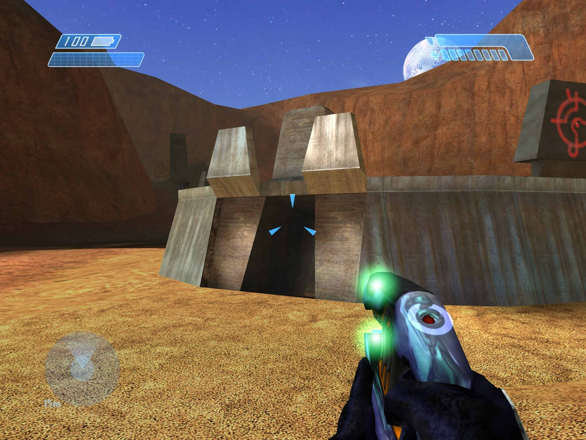

# Halo: Combat Evolved for Mac

Halo: Combat Evolved, running natively on Macs with Apple silicon. This is
[OpenCE](https://github.com/OpenCommunityEdition/OpenCE), the port of the
Halo: Combat Evolved decompilation to modern systems, with a port to macOS:
one app, the whole campaign, split screen, system link and internet play
with the Linux, Windows, Android and web builds, a widescreen high-resolution
picture on Metal, and keyboard, mouse and controller support.



## Download

**[Download Halo.dmg](https://github.com/channelramble/OpenCE-macOS/releases/latest/download/Halo.dmg)**
(about 19 MB) from the [latest release](https://github.com/channelramble/OpenCE-macOS/releases/latest).

You need:

- a Mac with Apple silicon (M1 or later). Intel Macs cannot run it.
- macOS 11 Big Sur or later (tested on macOS 27).
- your own disc image (`.iso` or `.xiso`) of Halo: Combat Evolved for the
  original Xbox, any version. The game data is not included: it is
  Microsoft's.

## Install

1. Open **Halo.dmg** and drag **Halo** into **Applications**.
2. Open **Halo** from Applications. The app is not notarized by Apple, so the
   first time macOS says that it cannot check it: click **Done**, open
   **System Settings > Privacy & Security**, scroll down to "Halo was
   blocked" and click **Open Anyway**, then confirm. (You do this once.)
3. The first time the game starts, it asks for your disc image: click
   **Yes** and select it. It copies the game's maps (about 2 GB), then the
   game starts. You can delete the disc image afterwards.

That is all: the next starts go straight to the game.

## Your files

Halo keeps its files in `~/Library/Application Support/OpenCE` (in the
Finder: **Go > Go to Folder**, then paste that path):

| What | Where in that folder |
| --- | --- |
| The game's maps | `maps` |
| Saved games and profiles | `save` |
| Settings (every setting, with its explanation) | `config.toml` |
| Screenshots (**F10**) | `screenshots` |
| Custom Edition maps | `custom_maps` |
| Logs | `debug.txt`, `halo.log` |

To start again from nothing, quit Halo and delete that folder. To remove the
game, also drag Halo from Applications to the Trash.

## Playing

- Keyboard and mouse as on Halo PC: **W A S D** to move, the mouse to aim,
  **left click** to fire, **right click** or **G** for grenades, **space** to
  jump, **control** or **C** to crouch, **F** to melee, **R** to reload,
  **E** for actions, **Q** for the flashlight, **Z** to zoom, **tab** for the
  scores, **escape** for the pause menu. Settings > Controls Setup changes
  them.
- Controllers (Xbox, PlayStation, Switch Pro and others that macOS knows)
  work at once; more controllers are players 2 to 4 in split screen.
- **fn+F11** changes between fullscreen and a window, **fn+F12** releases or
  captures the mouse, **⌘Q** quits. (If fn+F11 shows the desktop instead,
  turn off "Show Desktop" in System Settings > Keyboard > Keyboard
  Shortcuts > Mission Control.)
- Multiplayer: system link on your local network, and internet play with an
  invite link, with players on every OpenCE platform. macOS may ask for
  permission to use the local network (the first network game) and the
  microphone (voice chat): allow them.

The controls, the menus, every setting and the multiplayer functions are
described in [port/linux/README.md](port/linux/README.md) (the Mac uses the
same game code as Linux), and what is particular to the Mac in
[port/macos/README.md](port/macos/README.md).

## Build it yourself

On a Mac with Apple silicon, with the Xcode command line tools and
[Homebrew](https://brew.sh):

```sh
brew install llvm lld ninja cmake
git clone https://github.com/channelramble/OpenCE-macOS.git
cd OpenCE-macOS
python3 configure.py --release
ninja macos_dmg
```

The app is `build/macos/Halo.app`, and its disk image `build/macos/Halo.dmg`.
[port/macos/README.md](port/macos/README.md) explains how the port works
(the game is 32-bit code, which Apple silicon Macs cannot run as it is: it
runs in a 4 GB window of its own, which a rewrite of its compiled code
addresses), and how to sign and notarize the app with a Developer ID.

## Credits and legal

- The game's code is the decompilation of the original Xbox game by the
  [punpckhdq/halo](https://github.com/punpckhdq/halo) and
  [bnunu/halo-1](https://github.com/bnunu/halo-1) projects.
- [OpenCE](https://github.com/OpenCommunityEdition/OpenCE) ports it to Linux,
  Windows, Android and the web; this repository adds macOS. Their code is
  CC0 ([LICENSE.md](LICENSE.md)); the libraries in the app are under their
  own licences (`Halo.app/Contents/Resources/Licenses.txt`).
- Halo is a trademark of Microsoft. This is a fan project, not affiliated
  with or endorsed by Microsoft, Bungie or Xbox. It contains no game data:
  you need your own copy of the game.

---

# About OpenCE: Halo: Combat Evolved for Linux, Windows, macOS, Android and the web

[](https://discord.gg/9gqcHyr5km)

This project is a port of the Halo: Combat Evolved decompilation to Linux,
Windows, macOS, Android and web browsers. The decompilation is of the Xbox build 2342
(`cachebeta.exe`, SHA-256
`4cc87b45f721270392a96f1674ed2b5cd4a7bb4355faeab4531d1cf1884d9520`).


The port starts from the decompilation of [bnunu/halo-1](https://github.com/bnunu/halo-1).
That project is a fork of [punpckhdq/halo](https://github.com/punpckhdq/halo).

## Download

GitHub Actions builds the game for each commit. These links download the
builds of the latest release:

| Platform | Release | Debug |
| --- | --- | --- |
| Linux | [halo-linux-release.zip](https://github.com/OpenCommunityEdition/OpenCE/releases/latest/download/halo-linux-release.zip) | [halo-linux-debug.zip](https://github.com/OpenCommunityEdition/OpenCE/releases/latest/download/halo-linux-debug.zip) |
| Windows | [halo-windows-release.zip](https://github.com/OpenCommunityEdition/OpenCE/releases/latest/download/halo-windows-release.zip) | [halo-windows-debug.zip](https://github.com/OpenCommunityEdition/OpenCE/releases/latest/download/halo-windows-debug.zip) |
| Android | [halo-android-release.zip](https://github.com/OpenCommunityEdition/OpenCE/releases/latest/download/halo-android-release.zip) | [halo-android-debug.zip](https://github.com/OpenCommunityEdition/OpenCE/releases/latest/download/halo-android-debug.zip) |
| macOS (Apple silicon) | [Halo.dmg](https://github.com/channelramble/OpenCE-macOS/releases/latest/download/Halo.dmg) (this repository's releases) | build it: [port/macos/README.md](port/macos/README.md) |
| Web | [halocombatevolved.com](https://halocombatevolved.com/) (or [halo-web-release.zip](https://github.com/OpenCommunityEdition/OpenCE/releases/latest/download/halo-web-release.zip) for your own server) | [halo-web-debug.zip](https://github.com/OpenCommunityEdition/OpenCE/releases/latest/download/halo-web-debug.zip) |

The macOS download holds `Halo.dmg`: open it and drag Halo to Applications.
It is not notarized: refer to [port/macos/README.md](port/macos/README.md)
to open it the first time.

Use the release build to play. The debug build stops at the first failed
assertion and writes it to the log. Use the debug build to find and report
problems.

The game updates itself. At start-up it looks for a newer release, and asks
if you want to install it. Refer to "Updates" in
[port/linux/README.md](port/linux/README.md#updates). The web site offers
each new build when it is out.

Each build of the `main` branch that passes on all four platforms is a new
release, and the web site then plays it. The [Releases](https://github.com/OpenCommunityEdition/OpenCE/releases)
page keeps the last five releases. If the latest build has a problem, get
an older build from that page.

## Game data

The port does not include the game data. Download an Xbox disc image
(`.xiso` or `.iso`) of Halo: Combat Evolved. All versions of the game
operate. The maps of the European (PAL) version were made for a slower
console. The port changes them to play as the North American (NTSC) maps do,
so players of the two versions can play together.

1. Start the game.
2. At the first start, the game asks for the disc image. Select it.
3. The game extracts the `maps/` folder. Then the game starts.

On Linux and Windows, the game puts `maps/` next to the executable. On
macOS, it puts `maps/` in `~/Library/Application Support/OpenCE`. On
Android, copy the disc image to the phone first. The app puts `maps/` in its
data folder. Refer to [port/android/README.md](port/android/README.md). On
the web, the page copies `maps/` out of the disc image into the browser's
storage for the site; nothing is uploaded. Refer to
[port/web/README.md](port/web/README.md).

## Platforms

Each platform has its own instructions:

| Platform | Instructions |
| --- | --- |
| Linux (32-bit x86 executable, OpenGL 4.5, SDL3) | [port/linux/README.md](port/linux/README.md) |
| Windows (32-bit x86 executable, OpenGL 4.5, SDL3) | [port/windows/README.md](port/windows/README.md) |
| macOS (Apple silicon app, OpenGL ES 3 on Metal through ANGLE, SDL3) | [port/macos/README.md](port/macos/README.md) |
| Android (arm64 app, OpenGL ES 3, SDL3) | [port/android/README.md](port/android/README.md) |
| Web (WebAssembly, WebGL 2, SDL3; desktop Chrome, Edge and Firefox) | [port/web/README.md](port/web/README.md) |

The Linux README also gives the controls, the settings and the multiplayer
functions. These are almost the same on all platforms.

## Multiplayer

The game can play system link games on a local network and on the internet:

- A system link game can have up to 128 players on up to 128 machines.
- Linux, Windows, macOS and Android machines and browsers can play in the
  same game. On a local network, the native builds play system link; browsers
  play each other in rooms, over WebRTC
  ([port/web/README.md](port/web/README.md)).
- An invite link, or the server browser, lets a machine join a game on the
  internet, browsers too: a native build takes a browser's WebRTC
  ([port/linux/README.md](port/linux/README.md), "Browsers"). No server of
  this project is necessary.
- The netcode is new. Each machine moves its own player at once,
  and the host makes the decisions for the game. Refer to
  [port/linux/NETCODE.md](port/linux/NETCODE.md).

## Build the game

You do not need the Xbox SDK. The port supplies the SDK declarations that
the game uses. Refer to [port/include/xdk](port/include/xdk/README.md).

To build the game:

1. Install Python and [ninja](https://ninja-build.org/).
2. Install the tools for your platform. Refer to the README for the
   platform.
3. In the root folder of the repository, enter `python configure.py`.
4. Enter `ninja` with the target for the platform:

| Target | Result |
| --- | --- |
| `ninja linux` | `build/linux/halo` |
| `ninja windows` (on Windows) | `build/windows/halo.exe` and `SDL3.dll` |
| `ninja macos` (on macOS) | `build/macos/Halo.app` (`ninja macos_dmg`: `build/macos/Halo.dmg`) |
| `ninja android_apk` | `port/android/app/build/outputs/apk/debug/app-debug.apk` |
| `ninja web` | `build/web/site/`, the web site (`python tools/web_serve.py` serves it) |

If you enter `ninja` without a target, ninja builds the game for the
computer that you use.

`tools/ci_build.py` makes the same builds as GitHub Actions. For example,
enter `python tools/ci_build.py linux release`.

### Build options

Give these options to `configure.py`:

| Option | Result |
| --- | --- |
| (none) | A debug build. A failed assertion stops the game. |
| `--release` | A release build. The game does not examine assertions, as in the retail game. |
| `--portable` | The Linux and Windows builds operate on all x86-64 processors. The Linux build also operates on older distributions and on SteamOS: refer to "Portable build" in [port/linux/README.md](port/linux/README.md#portable-build). Use this option for builds that you give to other persons. |
| `--lto=thin`, `--lto=off` | Less link-time optimization. The link is faster. |
| `--pgo=off` | No profile-guided optimization. |
| `--pgo=train` | Records a new optimization profile. Refer to "Optimization profiles". |
| `--profile` | A profiling build. It records CPU times. Refer to "Profiling builds". |
| `--web-emcc PATH` | The Emscripten `emcc` for `ninja web` (else the one on the PATH, or `~/emsdk`'s). |

Without `--portable`, the Linux and Windows builds use all the instructions
of the processor that builds them (`-march=native`). Such a build does not
always start on a different computer.

### Optimization profiles

The builds use profiles of the game to optimize the code:

- `pgo/halo_linux.profdata` for Linux and Android.
- `pgo/halo_windows.profdata` for Windows.

The profiles need clang 22 or later. With an older clang, the builds do not
use the profiles.

To record a new profile:

1. Delete the profile.
2. Enter `python configure.py --pgo=train`.
3. Enter `ninja linux` or `ninja windows`.

The build then plays the main menu and the first minute of each campaign
level. This procedure continues for approximately 15 minutes. The game
data must be in `assets/`.

### Profiling builds

A profiling build records where the game spends its time.

1. Enter `python configure.py --profile`, then build as usual.
2. Start a recording. Enter `profile_record` in the console (or the telnet
   console), or set `debug.profile_record = true` in `config.toml`. To
   record each game of a session, also set
   `debug.profile_record_when = "game"`.
3. Stop the recording. Enter `profile_stop`, load another map, or quit.

The game writes numbered `.part<n>.json` files under `profiles/` in its data root
and logs their paths. Parts are retained after the recording stops. Logs go to
standard error; a Windows release build without standard error writes them to
`halo.log` next to `halo.exe`.

`tools/net_report.py` is a helper for developers. Enter
`python tools/net_report.py <recording.part1.json>` to read a recording
as tables. The command also writes `<recording>.summary.txt`, a short text
file.

| Command | Result |
| --- | --- |
| `profile_record [seconds]` | Starts a recording. With a number of seconds, the recording stops after that time. |
| `profile_stop` | Stops the recording. |

`debug.profile_memory` sets the memory of a recording in MB (default 256,
from 4 to 1024). A recording has no length limit:
the game writes a part each time the memory is full. Refer to "Settings" in
[port/linux/README.md](port/linux/README.md).

On Android, the files are in `/sdcard/Android/data/com.halo.decomp/files/profiles/`.
Enter `adb pull` to copy the recording parts to a computer.

A profiling build plays with normal builds. It does not use
`--pgo=train`.
